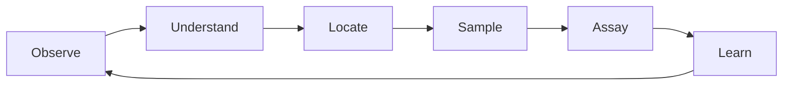
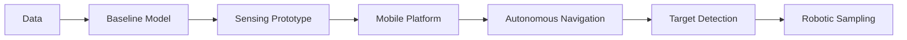

# Sensa

### Autonomous Mineral Intelligence

Sensa is an early stage deep tech project exploring the use of AI, robotics, sensing, and geological data for mineral exploration and, eventually, mineral processing in Africa.

We are starting with a simple question:

> Can we build a machine that can enter difficult terrain, observe the geology around it, identify potentially interesting targets, and collect useful ground truthed data?

The long term goal is bigger than the rover.

We want to build the data and intelligence infrastructure that allows machines to understand African geological environments.

---

## The core loop

The most important asset is therefore high quality, ground truthed geological data. The rover is our mechanism for collecting it.

---

## What we're building

### Sensa Rover

A mobile platform capable of:

* Autonomous or semi-autonomous navigation
* Terrain perception
* Geological sensing
* Computer vision
* Edge AI inference
* Target detection
* Geolocation
* Remote teleoperation
* Eventual robotic sampling

### Sensa Intelligence

The software and ML layer responsible for:

* Geological classification
* Mineral identification
* Anomaly detection
* Target identification
* Sensor fusion
* Exploration intelligence

### Sensa Data

A growing collection of:

* Geological imagery
* Sensor observations
* Spectral data
* Terrain data
* Geological context
* Physical samples
* Laboratory assays
* Rover telemetry

The goal is to connect these into traceable, ground truthed observations.

---

## The first principle

**Data before complexity.**

We do not want to build a sophisticated rover and discover later that we don't have useful data to train or validate the intelligence.

Our initial progression is:

Every stage should produce evidence for the next.

---

## Current focus

**Phase 0: Data and research**

We are currently investigating:

1. What geological data already exists?
2. What African geological data can legally be obtained?
3. What can we collect ourselves?
4. What ground truth can we obtain through physical samples and laboratory assays?
5. What is the smallest useful ML problem we can solve first?
6. What sensors are actually necessary?

---

## Project documents

| Document                                          | Purpose                                          |
| ------------------------------------------------- | ------------------------------------------------ |
| [`01-VISION.md`](docs/01-VISION.md)               | Why Sensa exists and where it is going           |
| [`02-PROBLEM.md`](docs/02-PROBLEM.md)             | The problem we are trying to solve               |
| [`03-DATA-STRATEGY.md`](docs/03-DATA-STRATEGY.md) | Our most important asset: data                   |
| [`04-ROVER.md`](docs/04-ROVER.md)                 | Rover concept and system architecture            |
| [`05-AI-SYSTEM.md`](docs/05-AI-SYSTEM.md)         | ML and intelligence layer                        |
| [`06-NAVIGATION.md`](docs/06-NAVIGATION.md)       | Autonomous navigation                            |
| [`07-SAMPLING.md`](docs/07-SAMPLING.md)           | Physical sampling system                         |
| [`08-DATA-PIPELINE.md`](docs/08-DATA-PIPELINE.md) | From sensor observation to dataset               |
| [`09-MVP.md`](docs/09-MVP.md)                     | What we are actually building first              |
| [`10-RESEARCH.md`](docs/10-RESEARCH.md)           | Open questions, papers, experiments and findings |

---

## Status

**Stage:** Early research and technical validation

**Working name:** Sensa

**Initial physical system:** Exploration rover

**Primary technical areas:**

`Robotics` · `Computer Vision` · `Edge AI` · `Embedded Systems` · `Geospatial Systems` · `Geology` · `Machine Learning`

---

## Guiding principle

> Build the smallest system that can teach us something real.

The architecture, hardware, and models are expected to change as we learn.