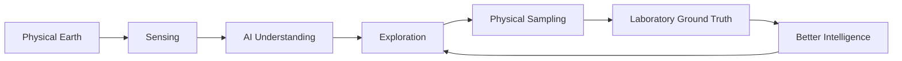
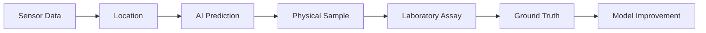
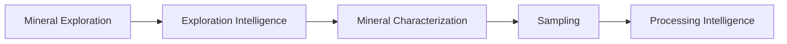
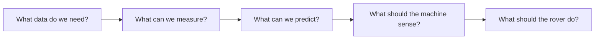

# Sensa Vision

**Status:** Working vision
**Last updated:** September 2026

## What is Sensa?

Sensa is a deep tech project exploring how AI, robotics, sensing, and geological intelligence can be used to understand and explore mineral resources.

We are starting with mineral exploration. The first physical system we are building toward is an autonomous or semi-autonomous exploration rover.

But the rover is only the beginning.

## The bigger idea

We want to build machines that can see, understand, explore, sample, and learn.

The long term goal is to connect the physical world to intelligent systems that can continuously learn from it.

## Why mineral exploration?

Mineral exploration is a physical world problem. The information we need is usually:

- underground or hard to access
- spatially distributed
- expensive to collect
- dependent on physical samples
- hard to interpret at scale

That combination sits right at the intersection of robotics, embedded systems, sensors, AI, and geology. That intersection is where Sensa starts.

## Why Africa?

Africa holds significant mineral resources and an increasingly important role in global mineral supply chains.

Our focus is not simply how to extract more minerals. The question we are asking is how to build more of the technology and intelligence around Africa's own mineral resources: systems that can collect, understand, and process information about African geological environments, designed with the environments, constraints, and data of the region in mind.

## The data vision

The most valuable long term asset may not be the rover. It may be the data generated by operating it.

A useful Sensa observation could eventually connect sensor data all the way back to a validated result:

Over time this becomes a growing body of ground truthed African geological data. That data improves the machines. The machines then collect better data. That loop is the foundation of the Sensa intelligence layer.

## Where we want to go

We are starting with mineral exploration. From there, the path could extend toward exploration intelligence, mineral characterization, sampling, and processing intelligence. Eventually Sensa could become a broader platform for intelligent systems operating around Earth's physical resources.

The exact path is intentionally not fixed. We want the technology and evidence we collect along the way to determine how far the system expands.

## What we are building now

Right now we are not building the final autonomous mining machine. We are answering smaller questions first:

The first real milestone is not "we built a rover." It is "we built a system that can collect useful data, make a meaningful prediction, and validate that prediction against the physical world."

Everything else builds from there.

## The vision

Sensa aims to build intelligent machines that understand the physical Earth and help humans explore it.

Starting with minerals. Starting in Africa. Starting with data.

Prepared by:
Darlene Wendy