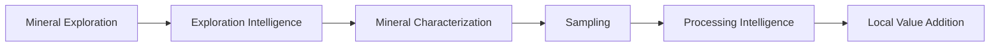
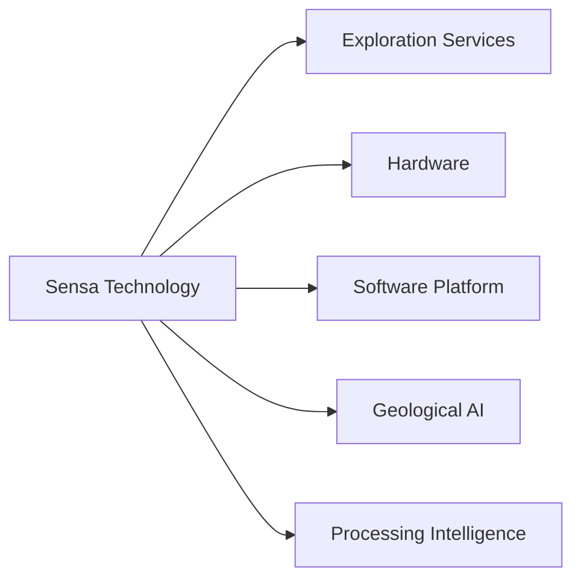
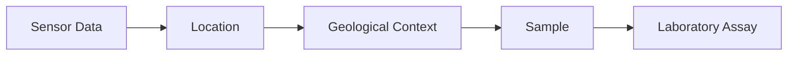
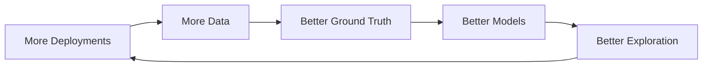

# Sensa Problem

**Status:** Early research
**Type:** Commercial and technical

## The bigger problem

Africa has significant mineral resources, but having minerals in the ground is not the same as capturing their full economic value.

There is a gap between finding, extracting, characterizing, processing, and manufacturing:

Much of the technology, infrastructure, and expertise required for the later stages is still limited in many African markets. That creates an opportunity to build more of that intelligence and capability locally.

## 1. We need to know what we have

Mineral exploration is an information problem.

Before investing heavily in extraction, operators need to understand:

* Where potentially valuable mineralization exists
* What geological material is present
* Where to sample
* What the material contains
* Which areas deserve further investigation

Collecting this information can require significant field work, specialist expertise, equipment, laboratory analysis, and time. Poor information creates economic risk.

## 2. Finding minerals is not enough

Even after a mineral deposit is identified, another question remains: what can we actually do with the material.

Different ores and mineral deposits require different methods of characterization, beneficiation, concentration, refining, and processing. If we cannot accurately understand the material, it becomes harder to determine how it should be processed and what economic value can potentially be recovered from it.

This creates another intelligence problem: what is the material, what does it contain, and how should we process it.

## 3. The value addition gap

A mineral can leave its country of origin as a relatively low value raw material and later become part of a much higher value processed or manufactured product. The more processing and manufacturing that happens elsewhere, the more of the downstream economic activity also happens elsewhere.

The opportunity is therefore bigger than how do we find more minerals. It is how do we build the technology and intelligence that allows African operators to better understand, process, and add value to the minerals we already have.

This does not mean every mineral should necessarily be processed locally. Processing economics, energy requirements, infrastructure, technology, environmental considerations, and market demand all matter. The question is where technology can make more local value addition technically and economically viable.

## 4. The Sensa opportunity

Sensa starts at exploration because understanding the material comes first. The long term direction is:

The technology we develop for exploration can eventually contribute to understanding and optimizing processes further downstream.

## The business problem

Customers spend money trying to answer questions such as:

* Where should we explore?
* What should we sample?
* What exactly is in the material?
* Which material is ore and which is waste?
* How variable is the deposit?
* How should the material be processed?
* How can recovery be improved?

If Sensa can answer some of these questions faster, more accurately, or at lower operational cost, there is a potential business.

## Initial business model

The first business model we want to investigate is exploration as a service.

Instead of requiring a customer to purchase the entire system, Sensa could operate the technology and deliver exploration intelligence.

Potential deliverables:

* Survey data
* Geological maps
* Target locations
* Sensor measurements
* Sample locations
* Physical samples
* Laboratory results
* Exploration analysis

## Longer term business

If the technology is validated, Sensa could expand beyond exploration.

Potential revenue streams include:

**Exploration services.** Deploy Sensa systems and deliver exploration intelligence.

**Hardware.** Sell or lease exploration systems.

**Software.** Provide tools for geological data, models, missions, and analysis.

**AI services.** Provide specialized geological and processing models.

## The data advantage

Every deployment could potentially connect sensor data, location, geological context, sample, and laboratory assay:

With appropriate agreements and data rights, this can create a growing dataset for improving Sensa's models.

The same principle could eventually extend into mineral characterization and processing.

## What we need to validate

Before building expensive hardware, we need evidence that:

* Customers have a real exploration problem
* They already spend money solving it
* Our system can reduce cost, time, or operational risk
* Our measurements are useful
* Our predictions can be validated
* Customers will pay for the resulting intelligence
* The economics of deployment make sense
* There are realistic pathways toward local mineral characterization and processing

## Core business question

> Can Sensa build technology that helps African operators understand their mineral resources better, explore them more efficiently, and eventually capture more value from them locally?

The rover is one possible tool for answering that question.

The company is bigger than the rover.