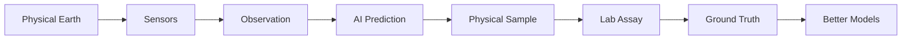
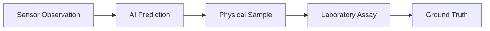
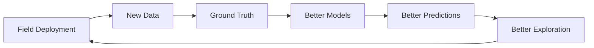
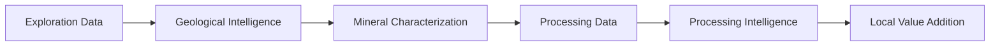
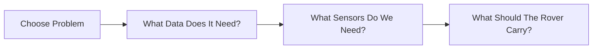
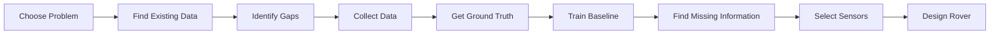

# Sensa Data Strategy

**Status:** Early research
**Priority:** First

## The idea

The rover is not the most valuable thing we are trying to build.

**Data is.**

Sensa needs to connect information from the physical Earth to AI models and eventually to decisions about exploration, characterization, and processing.

## What data do we need?

Initially, we are interested in data such as:

* Rock and geological imagery
* Spectral information
* Location
* Depth and terrain
* Geological context
* Sensor measurements
* Physical samples
* Laboratory assays
* AI predictions

Later, the data strategy can expand into:

* Mineral characterization
* Ore and waste classification
* Processing data
* Recovery rates
* Material properties
* Processing conditions
* Tailings and waste characteristics

The exact requirements should come from the problems we choose to solve.

## The most important connection

We do not want isolated datasets. We want to connect observations to physical reality.

This lets us ask whether the model was actually right. That matters more than simply having a large dataset.

## Where will the data come from?

### Existing data

We can start with:

* Public geological datasets
* Geological survey data
* Research datasets
* Remote sensing data
* Existing mineral datasets
* Open scientific datasets

We need to investigate their geographic coverage, labels, quality, metadata, licensing, and commercial use restrictions.

### Our own data

Eventually:

* Physical samples
* Controlled experiments
* Sensor measurements
* Field observations
* Rover missions
* Laboratory assays

This is where Sensa can begin building proprietary, ground truthed datasets.

### Potential partners

Potential sources include:

* Universities
* Geological institutions
* Laboratories
* Exploration companies
* Mining companies
* Processing facilities

Any commercial or confidential data must have clearly defined ownership and usage rights.

## Why African data?

We want to investigate whether existing mineral AI datasets and models adequately represent African geological environments. This is a hypothesis to test, not an assumption.

If important gaps exist, Sensa can focus on collecting data that is relevant to the environments in which we intend to operate.

The goal is not simply more data. It is better, relevant, ground truthed data.

## The data flywheel

If Sensa eventually operates across multiple exploration environments, each deployment could contribute new observations and ground truth.

With appropriate customer agreements, this could become a long term data advantage.

## From exploration to processing

The long term data vision follows the mineral value chain.

We should not attempt to collect all of this immediately. Each stage should be driven by a specific problem and a specific customer need.

## First data problem

Before designing the full rover, we choose one useful ML problem, then let it determine what follows.

In more detail, that path looks like:

## Immediate work

* Find relevant African geological datasets
* Understand what data already exists
* Check labels and metadata
* Check licensing
* Identify accessible physical samples
* Identify laboratory assay options
* Choose the first ML problem
* Build a small baseline dataset
* Train a baseline model
* Identify missing information
* Use those findings to guide the first hardware experiment

## Core principle

> Don't build a robot to collect data we haven't decided we need.

Data first. Rover second.