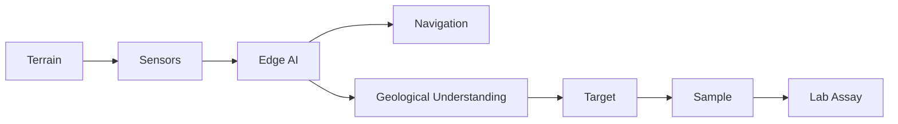
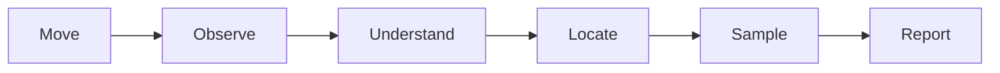
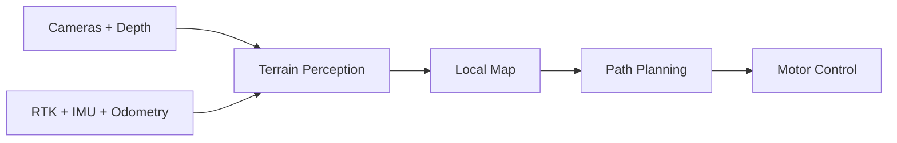
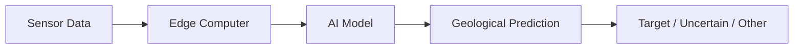
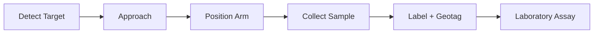
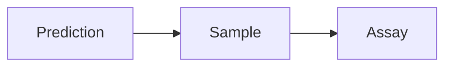
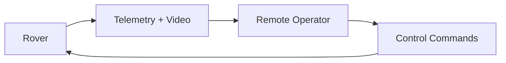
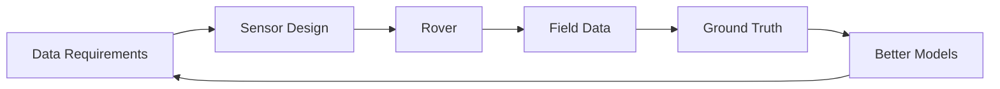
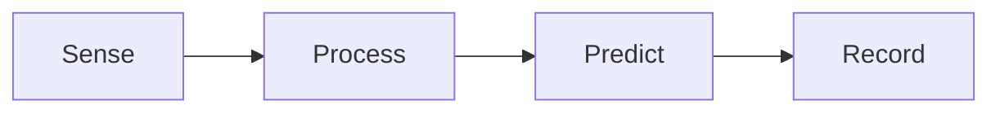
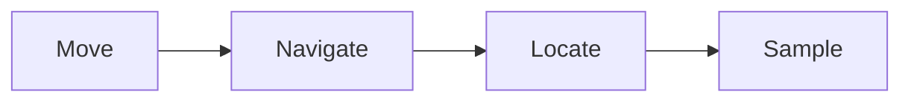

# Sensa Rover

**Status:** Early design
**Priority:** Core physical system

## What is the rover?

The Sensa Rover is a mobile platform for collecting geological information in places that are difficult, unsafe, or inefficient for humans to inspect manually.

It is not the whole Sensa system.

The rover is the **physical data collection and exploration layer**.

## What should it be able to do?

At a high level:

The rover should eventually be able to:

* Navigate difficult terrain
* Detect obstacles and unsafe paths
* Build an understanding of its surroundings
* Capture geological imagery and sensor data
* Identify potentially interesting geological targets
* Record exactly where observations were made
* Approach selected targets
* Collect physical samples
* Send telemetry and data to operators
* Continue operating when internet connectivity is unavailable

## Navigation

The rover needs to answer one question: where can I safely go.

For surface environments, navigation can combine:

* Cameras
* Depth perception
* RTK GNSS
* IMU
* Wheel odometry
* Local terrain mapping

The system should detect obstacles, estimate terrain traversability, and continuously select a safe path.

Underground environments are different. RTK GNSS will not work underground, so the rover will need other forms of localization such as visual, LiDAR, and inertial sensor fusion.

## Geological perception

Navigation answers where can I go. Geological perception answers what am I looking at.

The rover can combine different sensors such as:

* RGB cameras
* Spectral sensors
* Depth sensors
* Other geological sensors we identify through experimentation

The edge computer processes these observations and produces predictions.

The model does not automatically know the truth. A prediction should lead to a physical sample when appropriate.

## Sampling

The long term rover should be able to physically interact with selected targets.

This is important because the physical sample gives us ground truth. The system should eventually connect prediction to sample to assay, rather than treating an AI prediction as proof.

## Human in the loop

The rover should not require full autonomy from day one.

When autonomous navigation is uncertain or unsafe, a human operator should be able to take control.

The goal is to support operation even when the operator cannot physically see the rover. This enables non-line-of-sight teleoperation using live video, telemetry, and control data.

## Edge first operation

The rover should be capable of making important decisions locally.

Internet connectivity should not be a requirement for:

* Basic navigation
* Obstacle detection
* Sensor collection
* Local AI inference
* Safety decisions

Cloud systems can be used when connectivity is available for:

* Data synchronization
* Model updates
* Fleet monitoring
* Long term storage
* Deeper analysis

## The rover is a learning system

The first rover will not be the final rover.

We expect the system to evolve as we learn what data is actually useful.

This is why rover development follows the Data Strategy. We should not add a sensor simply because it is interesting. Every sensor should answer a question.

## First version

The first physical prototype does not need:

* Full autonomy
* A robotic arm
* Underground navigation
* Complex terrain planning
* Every possible geological sensor

The first useful prototype could simply do this:

Then we progressively add:

## Design principle

> Build the smallest machine that can collect useful ground truthed geological data.

Everything else comes after that.

Prepared by:
Darlene Wendy