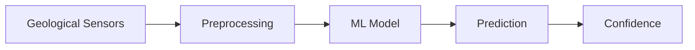
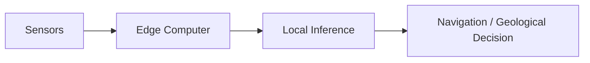

# Sensa AI System

**Status:** Early design

## What should AI do?

AI is not the rover.

It is the intelligence layer that helps the rover understand what its sensors are seeing and make useful predictions.

The system has three major intelligence problems:

* Where can I go?
* What am I looking at?
* What should I do next?

## 1. Terrain intelligence

The rover needs to understand its environment. It should detect:

* Obstacles
* Traversable terrain
* Unsafe terrain
* Terrain changes
* Relevant objects

This supports autonomous navigation.

## 2. Geological intelligence

The rover needs to understand what it is observing.

Potential inputs include:

* RGB imagery
* Spectral information
* Depth
* Location
* Geological context

Potential outputs:

* Material classification
* Geological target detection
* Ore or waste classification
* Anomaly detection
* Confidence and uncertainty

A prediction should not automatically be treated as truth. Physical samples and laboratory assays provide ground truth.

## 3. Decision intelligence

Eventually the system should combine perception with mission objectives.

For example: this area looks interesting, should the rover investigate it further.

The decision system can consider:

* Geological prediction
* Model confidence
* Distance
* Terrain difficulty
* Battery
* Mission objective
* Sampling requirements

## Edge AI

Important inference should happen on the rover where possible.

This reduces dependence on internet connectivity and allows the rover to respond locally. Cloud infrastructure can handle heavier processing, storage, training, and fleet level analysis when connectivity is available.

## Models will evolve

The first models will probably be simple. We can start with a baseline model and improve it as better data becomes available.

The goal is not to use the most sophisticated model. The goal is to build a model that is useful, measurable, and validated against the physical world.

## Core principle

AI should answer a real physical question. If a model does not improve an exploration decision, navigation decision, or sampling decision, we need to question why it exists.

Prepared by Darlene Wendy