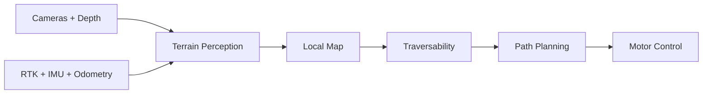
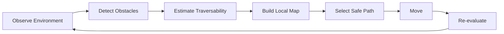
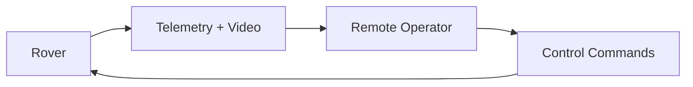

# Sensa Navigation

**Status:** Early design

## The problem

The rover needs to move through environments that may contain rocks, uneven terrain, slopes, obstacles, and changing conditions.

The navigation system needs to answer one question: where can I safely go.

## Perception

The rover can use sensor fusion rather than relying on one sensor.

Potential inputs:

* Cameras
* Depth
* RTK GNSS
* IMU
* Wheel odometry
* LiDAR

## Surface navigation

RTK GNSS can provide accurate positioning in suitable outdoor environments. Combined with other sensors, it can help the rover understand where it is and where it needs to go.

## Underground navigation

GNSS is unavailable underground. The navigation system will therefore need alternative localization methods such as:

* Visual localization
* LiDAR
* IMU
* Wheel odometry
* Sensor fusion

The exact approach will be determined through testing.

## Autonomous navigation

The rover should eventually:

## Human in the loop

Full autonomy is not required for every situation. When the rover encounters an uncertain or difficult environment, an operator should be able to take control remotely.

The rover should therefore support both autonomous navigation and remote teleoperation.

## Core principle

Autonomy when the rover is confident. Human control when it isn't.

Prepared by Darlene Wendy