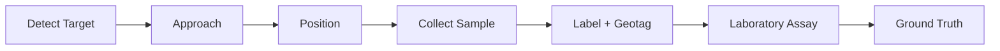
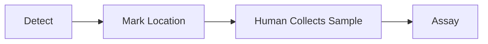

# Sensa Sampling

**Status:** Early design

## Why sampling matters

AI predictions are not ground truth. If the rover identifies an interesting geological target, we need a way to physically verify what is actually there. That makes sampling a critical part of the system.

## The basic process

## What the rover needs

Eventually, the sampling system may include:

* Robotic arm
* End effector or tool
* Sample container
* Sample identification
* Location tracking
* Camera verification

The exact mechanical design is not decided yet.

## Sample metadata

A useful sample should be connected to its context. Potential metadata:

* Sample ID
* GPS or local coordinates
* Depth
* Time
* Images
* Sensor readings
* AI prediction
* Model confidence
* Geological context

This turns a physical rock into a useful data point.

## Sampling decisions

The rover should not necessarily sample everything. Eventually, it could prioritize targets using:

* Geological prediction
* Model confidence
* Mission objectives
* Distance
* Terrain
* Available sampling capacity

## First version

The first prototype does not need an autonomous robotic arm. We can start with a simpler flow and automate more of it as the rest of the system becomes reliable.

## Core principle

Every important prediction should have a path to physical validation.

Prepared by Darlene Wendy