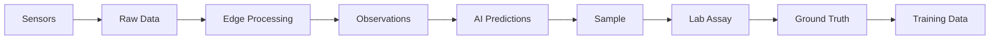
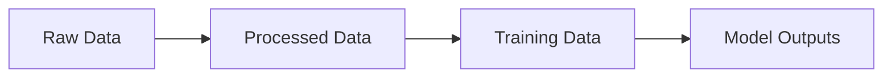
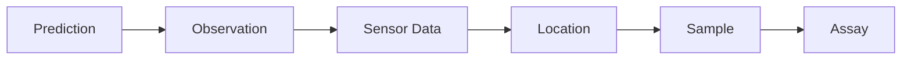
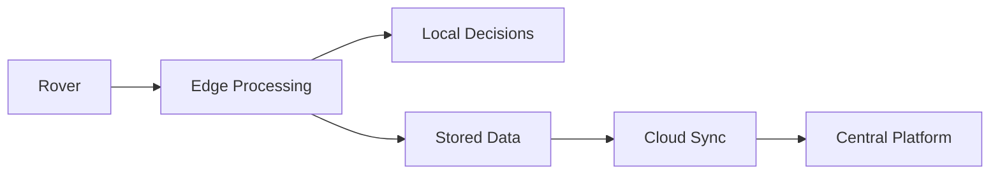

# Sensa Data Pipeline

**Status:** Early design

## The goal

Sensa needs to turn physical observations into usable, traceable data. The pipeline should connect what the rover sees to what actually exists in the physical world.

## Data from the rover

Potential data includes:

* Images
* Spectral measurements
* Depth
* Location
* Orientation
* Terrain information
* Telemetry
* AI predictions
* Sample metadata

## Data storage

The system will eventually need to separate raw data, processed data, training data, and model outputs.

This makes experiments reproducible and prevents us from losing the original observations.

## Traceability

Every important observation should be traceable back to its source.

This becomes especially important when evaluating model performance.

## Edge vs cloud

The rover should continue operating without a constant internet connection. When connectivity becomes available, collected data can synchronize with the central system.

## Long term data platform

Eventually, the collected data could support:

* Model training
* Model evaluation
* Exploration analysis
* Geological mapping
* Fleet monitoring
* Research
* Customer reporting

## Core principle

Keep the raw observation. Keep the context. Keep the ground truth.

Prepared by Darlene Wendy