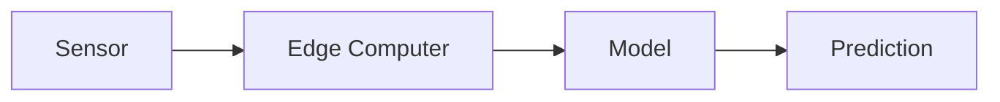
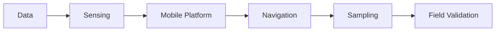

# Sensa MVP

**Status:** Not yet finalized

## The goal

The MVP is not a fully autonomous mining robot. The first goal is to prove that Sensa can collect useful physical data and turn it into a validated prediction.

## MVP 0: Data

Start without a rover. Choose one narrow geological problem.

Questions:

* Can we get the data?
* Are the labels useful?
* Can a model learn anything meaningful?
* What information is missing?

## MVP 1: Sensing

Build a small sensing prototype.

The objective is to test whether the physical sensing approach works.

## MVP 2: Mobile platform

Put the sensing system on a simple mobile platform. The first rover does not need a robotic arm or full autonomy. It needs to move, sense, record, and communicate.

## MVP 3: Navigation

Add:

* Obstacle detection
* Local mapping
* Basic autonomous movement
* Remote teleoperation

## MVP 4: Sampling

Add physical sampling once the sensing and navigation systems are reliable enough.

## MVP direction

Each stage should prove something before the next stage becomes more complex.

## What success looks like

The first meaningful milestone is not "we built a rover." It is "our system collected physical data, made a prediction, and we validated that prediction against the real world."

That is the beginning of a defensible system.

Prepared by Darlene Wendy